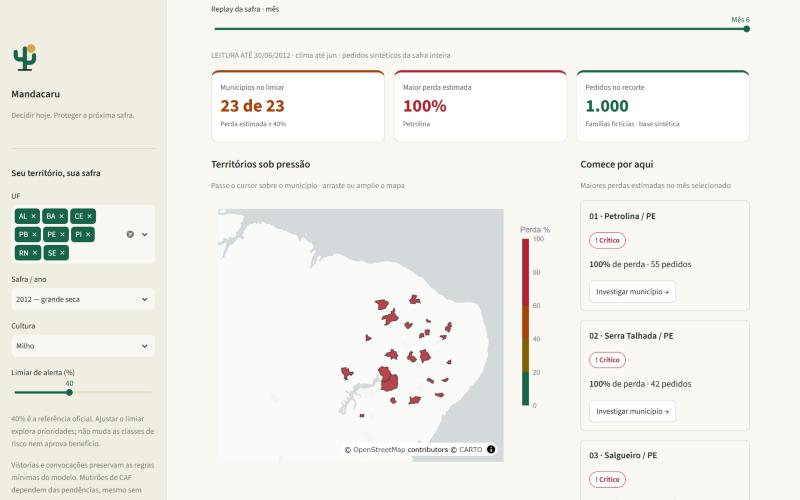
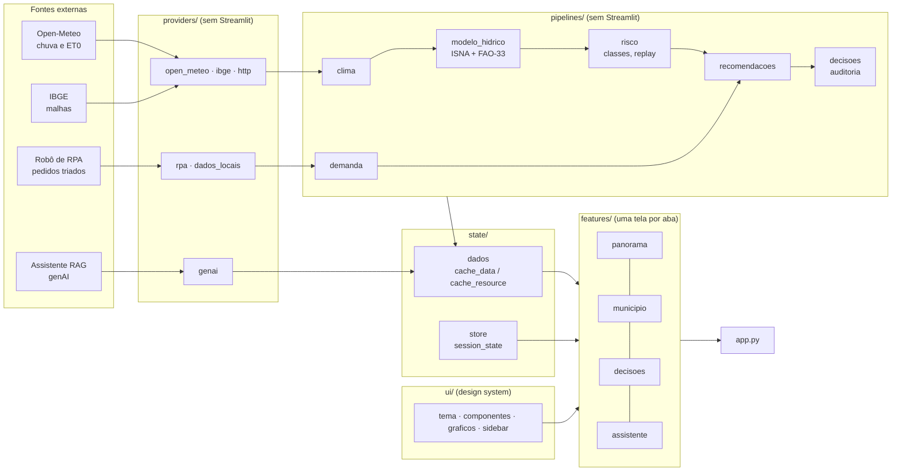
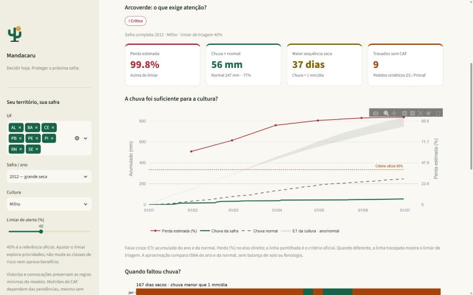
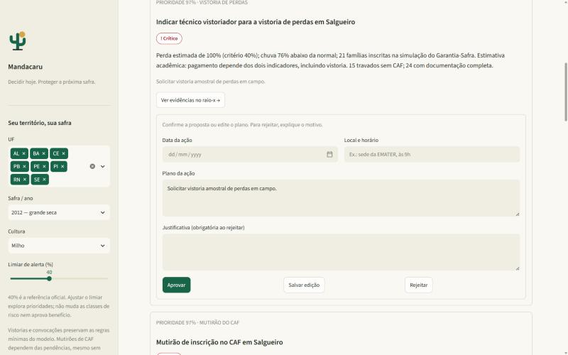

# 🌵 Mandacaru — onde agir primeiro na seca do semiárido

Global Solution 2026 · FIAP · **Front-end e Mobile Development em Sistemas de IA** · Turma 2TIAPF

| Nome completo | RM |
|---|---|
| Luís Fernando de Oliveira Salgado | RM561401 |
| Ricardo de Paiva Melo | RM565522 |
| Jonas Alaf | RM566479 |



## O problema

Quando a seca chega ao semiárido, o agricultor familiar perde a safra e depende do **Garantia-Safra**. Pela
Carta de Serviço oficial, o benefício só é pago num município quando **dois indicadores** mostram perda mínima de
**40%**: (a) os **laudos de vistoria** feitos por técnicos em campo e (b) o **Modelo de Penalização Hídrica do
INMET**. Quem coordena o programa num estado precisa decidir, com pouca gente e muito território:

- **onde pedir a vistoria primeiro** — sem laudo, ninguém recebe;
- **onde fazer mutirão do CAF** — sem CAF ativo, o agricultor não entra no Garantia-Safra nem no Pronaf;
- **quem convocar** — quem já tem documentação completa.

O **Mandacaru** responde "onde agir primeiro, e como?". Ele estima o indicador hídrico com dados reais de chuva,
cruza com os pedidos que os agricultores fizeram ao robô de triagem e **recomenda ações que o gestor aprova, edita
ou rejeita**. O painel não decide sozinho: a perda estimada é uma aproximação, e a vistoria é humana — por isso o
fluxo humano no centro.

## Fontes de dados

| Fonte | O que entra | Como |
|---|---|---|
| [Open-Meteo Archive](https://open-meteo.com/en/docs/historical-weather-api) (CC BY 4.0) | chuva e evapotranspiração diárias de jan–jun de 8 safras (2012–2026) e normal 1991–2020, para 23 municípios | `providers/open_meteo.py`, snapshot em `data/` |
| [IBGE — API de Malhas](https://servicodados.ibge.gov.br/api/docs/malhas?versao=3) | polígonos dos 23 municípios (mapa) e códigos IBGE | `providers/ibge.py` |
| Robô de triagem ([citizentech-rpa](https://github.com/citizentech-fiap/citizentech-rpa)) | pedidos dos agricultores: serviço, documentos faltantes, município | `providers/rpa.py` — planilha viva do robô ou safra simulada (**sintética**, ~1.000 pedidos/ano) |
| Assistente RAG ([citizentech-genai](https://github.com/citizentech-fiap/citizentech-genai)) | regras oficiais dos serviços, com citação; rascunho das convocações | `providers/genai.py` (opcional) |

**Modelo hídrico** (`pipelines/modelo_hidrico.py`): perda = Ky × (1 − ISNA do ano ÷ ISNA da normal), em que ISNA é o
Índice de Satisfação das Necessidades de Água (água disponível ÷ água que a cultura precisa), usado no zoneamento
agroclimático, e Ky é o fator de resposta da produção ao déficit hídrico da FAO (Boletim 33) para milho ou feijão.
Comparar com a normal 1991–2020 é o que o próprio Garantia-Safra faz. Resultado: **2012 → perda mediana de 99%,
os 23 municípios críticos**; 2013 → 65%; 2016 → 31%; 2019–2026, com chuva acima da normal → ~0%.
É uma aproximação acadêmica, **não** o modelo oficial do INMET (ver [CONTRACTS.md](CONTRACTS.md)).

## Por que Streamlit

A equipe já usa Streamlit nos outros dois módulos da solução (o portal do robô), o que permitiu reaproveitar o
assistente RAG direto em Python, sem API intermediária. O ciclo de rerun, com `session_state` e cache, atende bem a
um painel de análise com filtros, e o deploy no Streamlit Community Cloud é gratuito.

## Arquitetura



| Camada | Pasta | Responsabilidade |
|---|---|---|
| Providers | `providers/` | HTTP com retry, gzip e cache em disco; leitura dos snapshots e da planilha do robô; conexão opcional com o RAG |
| Pipelines | `pipelines/` | indicadores climáticos, modelo hídrico, classes de risco, demanda por município, recomendações priorizadas, registro de decisões |
| State | `state/` | única porta para `st.session_state` (`store.py`) e wrappers com `st.cache_data`/`st.cache_resource` (`dados.py`) |
| UI | `ui/` | tokens de cor e tipografia, escala de risco única, componentes reutilizáveis, gráficos, sidebar |
| Features | `features/` | as quatro telas, que só compõem componentes com dados já processados |

`providers/` e `pipelines/` não importam Streamlit: rodam e são testados sem a interface
(`python -m pipelines.risco`, `python -m pipelines.recomendacoes`).

## As telas

1. **Panorama da seca** — mapa dos 23 municípios colorido pela perda estimada, com **replay mês a mês** da safra;
   cartões de resumo; "comece por aqui" com os municípios mais críticos e mini-gráficos de chuva.
2. **Raio-x do município** — chuva acumulada × normal, demanda de água da cultura e linha do critério de 40%;
   calendário dos dias secos (Matplotlib); pedidos por serviço e **documento que mais trava** os agricultores.
3. **Mesa de decisão** — recomendações priorizadas (risco × famílias × gargalo do CAF), na ordem do processo real:
   vistoria → mutirão do CAF → convocação. O gestor **aprova** (com data, local e plano), **edita** ou **rejeita**
   (justificativa obrigatória). Convocações aprovadas geram rascunho de mensagem (RAG ou template) que o gestor
   revisa; tudo vai para um registro de auditoria.
4. **Assistente** — chat com o RAG sobre as regras dos serviços, com fontes; carrega sob demanda.

| Raio-x do município | Mesa de decisão |
|---|---|
|  |  |

## Requisitos da disciplina

| Requisito | Onde |
|---|---|
| `session_state` centralizado | `state/store.py` (`iniciar`, `obter`, `definir`, callbacks) |
| `st.cache_data` / `st.cache_resource` | `state/dados.py` — indicadores, séries e pedidos por filtro; RAG como recurso |
| Arquitetura em camadas | `providers/`, `pipelines/`, `features/`, `state/`, `ui/` + `app.py` fino |
| ≥ 3 filtros | sidebar: UF, safra/ano, cultura, limiar de alerta, serviço; + mês do replay |
| ≥ 2 gráficos, ≥ 1 Plotly | mapa coroplético, curva de chuva, barras de serviços e documentos (Plotly); calendário seco (Matplotlib) |
| Componentização real | `ui/graficos.py:grafico_chuva` (panorama e raio-x), `ui/componentes.py:kpi` e `badge_risco` (três telas) |
| Layout | abas, colunas, sidebar; narrativa do panorama à decisão |
| Design para latência | `st.spinner`/`st.status`, `st.progress` ao atualizar o clima por município, RAG sob demanda com indicador |
| Cores semânticas | `ui/tema.py`: seguro (verde), atenção (amarelo), alerta (laranja), crítico (vermelho) — sempre com ícone e rótulo |
| Human-in-the-loop | `features/decisoes.py` — aprovar/editar/rejeitar com validação; auditoria em `output/decisoes.jsonl` |

Mapa completo requisito → arquivo:função em [docs/RELATORIO_TAREFA_B.md](docs/RELATORIO_TAREFA_B.md).

**Diferenciais:** integração com o modelo de outra disciplina (classificador e OCR do robô, RAG do genAI);
múltiplas fontes cruzadas (clima + mapa + pedidos); design system próprio (nome, logo, tema, escala de risco);
testes automatizados das camadas de dados e da interface (`streamlit.testing.AppTest`); storytelling do panorama
ao detalhe e à decisão.

## Como executar

```bash
python -m venv .venv
.venv\Scripts\activate            # Linux/Mac: source .venv/bin/activate
pip install -r requirements.txt
streamlit run app.py
```

Os snapshots de clima, mapa e pedidos já estão em `data/`: o painel abre sem internet (o mapa base precisa de
internet; sem ela, os municípios aparecem sobre fundo branco). Para baixar de novo os dados reais:
`python scripts/preparar_dados.py` (`--forcar` renova tudo).

**Opcional — assistente e pedidos ao vivo:** com o repositório `citizentech-genai` clonado ao lado
(`pip install -e ../genAI`) e a chave do Gemini no `.env` (fora do git), a aba Assistente e os rascunhos de
convocação usam o RAG. Com o robô `citizentech-rpa` ao lado, troque `fontes.pedidos` para `rpa` no
[config.yaml](config.yaml) para ler a planilha viva dele.

**Testes:** `python -m unittest discover -s tests` (44 testes: providers sem rede, modelo hídrico, risco, demanda,
recomendações, decisões e fluxos da interface).

## Limitações

- A perda estimada é uma **aproximação** do indicador hídrico (sem balanço de solo nem fases da cultura) e não
  substitui o modelo do INMET nem a vistoria.
- Clima de **reanálise** (Open-Meteo), não estação meteorológica do município.
- Pedidos de agricultores **sintéticos**, gerados com volume proporcional à perda estimada; não são contagens oficiais.
- Registro de decisões local (um gestor por vez); num uso real, banco de dados com autenticação.

## Parte da solução CitizenTech
| Repositório | Disciplina | Papel |
|---|---|---|
| [citizentech-rpa](https://github.com/citizentech-fiap/citizentech-rpa) | AI for RPA | robô que coleta as Cartas de Serviço e faz a pré-triagem dos pedidos |
| [citizentech-genai](https://github.com/citizentech-fiap/citizentech-genai) | Generative AI | assistente RAG com citação das fontes |
| **citizentech-dashboard** (este) | Front-end | painel de decisão do gestor |
