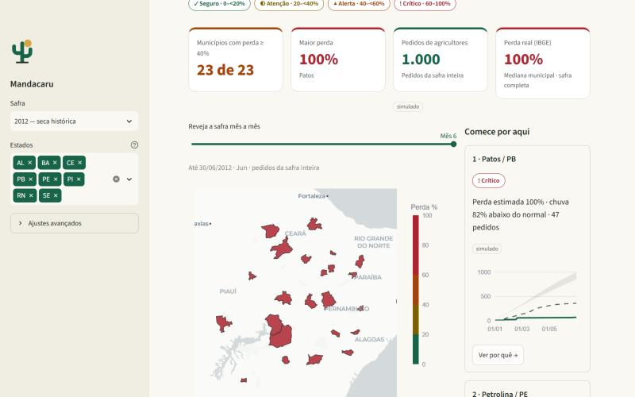
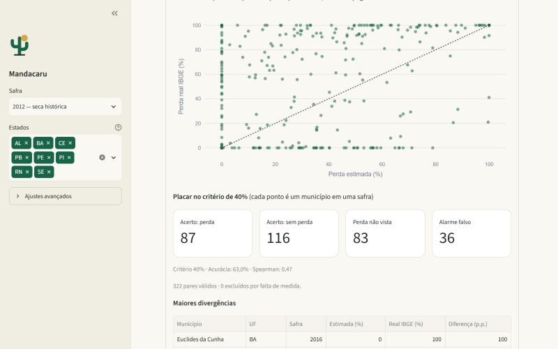
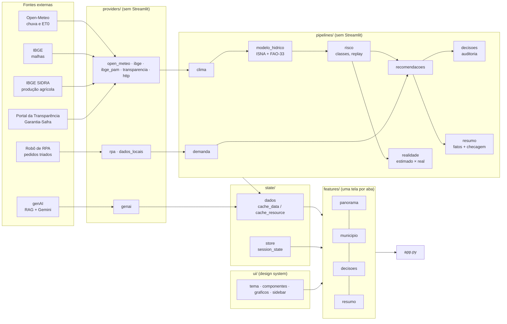
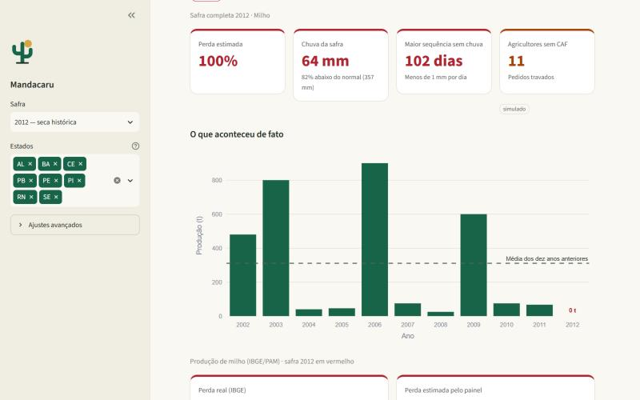
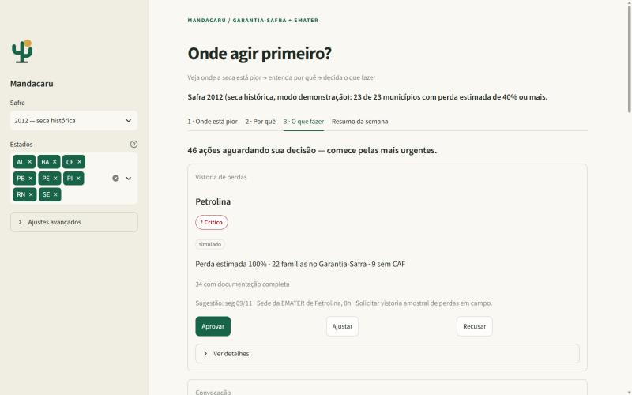

# 🌵 Mandacaru — onde agir primeiro na seca do semiárido

Global Solution 2026 · FIAP · **Front-end e Mobile Development em Sistemas de IA** · Turma 2TIAPF

| Nome completo | RM |
|---|---|
| Luís Fernando de Oliveira Salgado | RM561401 |
| Ricardo de Paiva Melo | RM565522 |
| Jonas Alaf | RM566479 |



## O problema

Quando a seca chega ao semiárido, o agricultor familiar perde a safra e depende do **Garantia-Safra**. Pela
Carta de Serviço oficial, o benefício só é pago num município quando **dois indicadores** mostram perda mínima de
**40%**: (a) os **laudos de vistoria** feitos por técnicos em campo e (b) o **Modelo de Penalização Hídrica do
INMET**. Quem coordena o programa num estado precisa decidir, com pouca gente e muito território:

- **onde pedir a vistoria primeiro** — sem laudo, ninguém recebe;
- **onde fazer mutirão do CAF** — sem CAF ativo, o agricultor não entra no Garantia-Safra nem no Pronaf;
- **quem convocar** — quem já tem documentação completa.

O **Mandacaru** responde "onde agir primeiro, e como?". Ele estima o indicador hídrico com dados reais de chuva,
cruza com os pedidos que os agricultores fizeram ao robô de triagem e **recomenda ações que o gestor aprova, edita
ou rejeita**. O painel não decide sozinho: a perda estimada é uma aproximação, e a vistoria é humana — por isso o
fluxo humano no centro. Para não pedir confiança cega, o painel mostra **o que aconteceu de fato** em cada safra
(produção do IBGE e pagamentos do Garantia-Safra) e o **placar do modelo** contra esses dados oficiais.

## Dados reais × simulados

Tudo o que descreve os municípios vem de **fontes públicas reais**. Só os pedidos individuais dos agricultores são
simulados — e aparecem com o selo **"simulado"** em cada tela.

| Fonte | O que entra | Tipo | Como |
|---|---|---|---|
| [Open-Meteo Archive](https://open-meteo.com/en/docs/historical-weather-api), modelo **ERA5** (CC BY 4.0) | chuva e evapotranspiração diárias de jan–jun das **15 safras de 2012 a 2026** e normal 1991–2020, para 23 municípios | real | `providers/open_meteo.py` |
| [IBGE — API de Malhas](https://servicodados.ibge.gov.br/api/docs/malhas?versao=3) | polígonos dos 23 municípios (mapa) e códigos IBGE | real | `providers/ibge.py` |
| [IBGE SIDRA — Produção Agrícola Municipal](https://sidra.ibge.gov.br/tabela/1612), tabela 1612 | área plantada, área colhida e produção de milho e feijão, 2002–2025 | real | `providers/ibge_pam.py` |
| [Portal da Transparência — Garantia-Safra](https://portaldatransparencia.gov.br/download-de-dados/garantia-safra) | famílias pagas e valor pago por município e safra, 2013–2026 | real, **agregado** | `providers/transparencia.py` |
| Cartas de Serviço do gov.br (via [citizentech-genai](https://github.com/citizentech-fiap/citizentech-genai)) | regras oficiais dos serviços; rascunho das convocações | real | `providers/genai.py` (opcional) |
| Robô de triagem ([citizentech-rpa](https://github.com/citizentech-fiap/citizentech-rpa)) | pedidos dos agricultores: serviço, documentos faltantes, município | **simulado** (~1.000 pedidos por safra) ou planilha viva do robô | `providers/rpa.py` |

**Por que os pedidos são simulados:** pedidos individuais são dado pessoal (LGPD), não são públicos, e a solução não
usa dado pessoal real. Em operação, esse dado nasce do próprio robô de triagem (cada pedido registrado com o motivo
da pendência); o protótipo simula essa entrada seguindo as regras das Cartas de Serviço.

**Privacidade no Garantia-Safra:** o arquivo mensal do Portal da Transparência traz nome e NIS de cada beneficiário.
O provider lê o ZIP **só em memória**, conta famílias distintas por município e safra e descarta o resto; nenhum
nome ou NIS é gravado em disco, no cache ou no git (há teste com ZIP sintético provando isso).

**Por que ERA5:** o modo padrão da Open-Meteo troca de modelo a partir de 2017 e infla a chuva no semiárido
(Quixadá, jan–jun/2019: 1.081 mm no padrão × 742 mm no ERA5). Ano e normal precisam vir do mesmo modelo.

**Modelo hídrico** (`pipelines/modelo_hidrico.py`): perda = Ky × (1 − ISNA do ano ÷ ISNA da normal), em que ISNA é o
Índice de Satisfação das Necessidades de Água (água disponível ÷ água que a cultura precisa), usado no zoneamento
agroclimático, e Ky é o fator de resposta da produção ao déficit hídrico da FAO (Boletim 33) para milho ou feijão.
Comparar com a normal 1991–2020 é o que o próprio Garantia-Safra faz. Resultado (milho, perda mediana):
**2012 → 97%, os 23 municípios ≥ 40%**; 2013 → 63%; 2021 → 53%; 2019, 2020, 2022 e 2024, com chuva perto ou acima
da normal → 0%. **Antes de 1º de março** o painel não estima perda (um ou dois meses de chuva são ruído): mostra só
o **sinal de chuva** (anomalia × normal). É uma aproximação acadêmica, **não** o modelo oficial do INMET (ver
[CONTRACTS.md](CONTRACTS.md)).

## O modelo acerta? Placar contra o dado oficial

`pipelines/realidade.py` compara, para cada município e safra de 2012 a 2025, a perda **estimada** pelo painel com a
perda **real** medida pelo IBGE (produção do ano × média dos dez anos anteriores — o mesmo critério do indicador do
IBGE citado na Carta do Garantia-Safra). Resultado no critério de 40% (`python -m pipelines.realidade`):

| Milho, 322 municípios-safra | Real < 40% | Real ≥ 40% |
|---|---:|---:|
| **Painel disse < 40%** | 116 (acertou: não houve perda) | 83 (perda que o modelo não viu) |
| **Painel disse ≥ 40%** | 36 (alarme falso) | 87 (acertou: houve perda) |



Acurácia **63%** (feijão: 58%), correlação de Spearman 0,47. O modelo **acerta as grandes secas** (2012: 23
estimados × 22 reais; 2013 e 2015 também batem), mas **não vê as perdas de 2016 a 2019** e dá alarme em 2021.
Ele olha só a chuva acumulada: perdas por chuva mal distribuída, pragas, preço ou área não plantada ficam de fora.
Por isso a recomendação é **pedir a vistoria**, nunca conceder o benefício — e por isso o placar está no painel
("Como calculamos"), e não escondido. Os dados reais são **retrospectivos**: nunca entram nas recomendações da
mesma safra (seria usar o futuro).

## Por que Streamlit

A equipe já usa Streamlit nos outros dois módulos da solução (o portal do robô), o que permitiu reaproveitar o
assistente RAG direto em Python, sem API intermediária. O ciclo de rerun, com `session_state` e cache, atende bem a
um painel de análise com filtros, e o deploy no Streamlit Community Cloud é gratuito.

## Arquitetura



| Camada | Pasta | Responsabilidade |
|---|---|---|
| Providers | `providers/` | HTTP com retry, gzip e cache em disco; leitura dos snapshots e da planilha do robô; conexão opcional com o RAG |
| Pipelines | `pipelines/` | indicadores climáticos, modelo hídrico, classes de risco, demanda por município, recomendações priorizadas, registro de decisões, validação contra o dado real, fatos do resumo semanal |
| State | `state/` | única porta para `st.session_state` (`store.py`) e wrappers com `st.cache_data`/`st.cache_resource` (`dados.py`) |
| UI | `ui/` | tokens de cor e tipografia, escala de risco única, componentes reutilizáveis, gráficos, sidebar |
| Features | `features/` | as quatro telas, que só compõem componentes com dados já processados |

`providers/` e `pipelines/` não importam Streamlit: rodam e são testados sem a interface
(`python -m pipelines.risco`, `python -m pipelines.recomendacoes`, `python -m pipelines.realidade`).

## Como usar (sem treinamento)

O painel foi desenhado para quem nunca o viu: as abas são os passos, e a decisão principal leva **2 cliques**.

1. **"1 · Onde está pior"** — o mapa mostra a perda estimada por município; ao lado, "Comece por aqui" lista os 3
   mais críticos. O slider "Reveja a safra mês a mês" mostra a seca avançando (em janeiro e fevereiro, só o sinal
   de chuva). O 4º cartão traz a **perda real do IBGE** da safra, quando já publicada. Clique **"Ver por quê →"**.
2. **"2 · Por quê"** — já aberto no município: quanto choveu × o normal, quantos dias sem chuva, **o que aconteceu
   de fato** (produção dos dez anos anteriores, perda real × estimada, famílias pagas pelo Garantia-Safra), a água
   que a plantação precisava e qual documento mais trava os agricultores. No fim, **"O que fazer em {município}"**.
3. **"3 · O que fazer"** — as 5 ações mais urgentes, na ordem do processo real (vistoria → mutirão do CAF →
   convocação). Cada cartão já mostra a sugestão (data, local e plano): **Aprovar** é 1 clique; **Ajustar** abre o
   formulário preenchido; **Recusar** exige o motivo. Convocações mostram a mensagem ao agricultor para revisão
   antes de confirmar. Tudo vai para um registro de auditoria ("Decisões já tomadas").
4. **"Resumo da semana"** — um clique gera, com IA (Gemini, pelo módulo genAI), o resumo para a coordenação:
   situação dos municípios, ações pendentes, decisões da semana e as três próximas ações. A IA recebe **só os
   números do painel** ("Fatos usados"); todo número do texto é conferido contra esses fatos, e um número que não
   está lá gera aviso. O gestor edita o texto e baixa em .txt. Sem chave ou sem rede, sai um resumo automático
   sem IA. (O chat para o agricultor tirar dúvidas fica no portal do robô, onde está quem tem a dúvida.)

Na barra lateral ficam só **Safra** e **Estados**; cultura, limiar, serviço e atualização dos dados estão em
"Ajustes avançados". O método fica em "Como calculamos". O layout funciona também na largura de celular.

| Por quê: o que aconteceu de fato em Patos (2012) | O que fazer: ações para aprovar |
|---|---|
|  |  |

## Requisitos da disciplina

| Requisito | Onde |
|---|---|
| `session_state` centralizado | `state/store.py` (`iniciar`, `obter`, `definir`, callbacks) |
| `st.cache_data` / `st.cache_resource` | `state/dados.py` — indicadores, séries, pedidos, perda real e validação; RAG como recurso; resumo da IA em cache por hash dos fatos |
| Arquitetura em camadas | `providers/`, `pipelines/`, `features/`, `state/`, `ui/` + `app.py` fino |
| ≥ 3 filtros | `ui/sidebar.py`: safra e estados à vista; cultura, limiar de alerta e serviço em "Ajustes avançados"; + mês do replay |
| ≥ 2 gráficos, ≥ 1 Plotly | mapa coroplético, curva de chuva, produção real × média, dispersão estimado × real, barras de serviços e documentos (Plotly); calendário seco (Matplotlib) |
| Componentização real | `ui/graficos.py:grafico_chuva` (abas 1 e 2), `ui/componentes.py:cartao_recomendacao` (abas 2 e 3), `kpi`, `badge_risco` e `selo_simulado` (várias telas) |
| Layout | abas numeradas como passos da jornada, colunas, sidebar enxuta, detalhes em expanders |
| Design para latência | `st.spinner`/`st.status`, `st.progress` ao atualizar o clima por município, RAG sob demanda com indicador |
| Cores semânticas | `ui/tema.py`: seguro (verde), atenção (amarelo), alerta (laranja), crítico (vermelho) — sempre com ícone e rótulo |
| Human-in-the-loop | `ui/acoes.py` — aprovar (1 clique, sugestão visível), ajustar, recusar com motivo; revisão da mensagem de convocação; resumo da IA editável antes de enviar; auditoria em `output/decisoes.jsonl` |

**Diferenciais:** integração com o modelo de outra disciplina (classificador e OCR do robô, RAG e Gemini do genAI);
cinco fontes públicas cruzadas (clima, mapas, produção agrícola, pagamentos, regras); **validação do modelo contra
o dado oficial**, com acertos e erros expostos; transparência sobre o que é simulado; design system próprio (nome, logo, tema, escala de risco);
testes automatizados das camadas de dados e da interface (`streamlit.testing.AppTest`); storytelling do panorama
ao detalhe e à decisão.

## Como executar

```bash
python -m venv .venv
.venv\Scripts\activate            # Linux/Mac: source .venv/bin/activate
pip install -r requirements.txt
streamlit run app.py
```

Os snapshots de clima, mapa, produção, pagamentos (agregados) e pedidos já estão em `data/`: o painel abre sem internet (o mapa base precisa de
internet; sem ela, os municípios aparecem sobre fundo branco). Para baixar de novo os dados reais:
`python scripts/preparar_dados.py` (`--forcar` renova tudo; `--etapas` escolhe entre malhas, clima, normal, pam,
garantia_safra e pedidos).

**Opcional — IA e pedidos ao vivo:** com o repositório `citizentech-genai` clonado ao lado
(`pip install -e ../genAI`) e a chave do Gemini no `.env` (fora do git), o "Resumo da semana" e os rascunhos
de convocação usam o Gemini e o RAG. Com o robô `citizentech-rpa` ao lado, troque `fontes.pedidos` para `rpa` no
[config.yaml](config.yaml) para ler a planilha viva dele.

**Testes:** `python -m unittest discover -s tests` (66 testes: codificação UTF-8 dos arquivos, providers sem rede
— incluindo SIDRA e um ZIP sintético do Garantia-Safra —, modelo hídrico, risco e replay, validação contra o dado
real, demanda, recomendações, decisões, resumo semanal com checagem de números e fluxos da interface).

## Limitações

- A perda estimada é uma **aproximação** do indicador hídrico (sem balanço de solo nem fases da cultura) e não
  substitui o modelo do INMET nem a vistoria.
- Clima de **reanálise** (ERA5 via Open-Meteo), não estação meteorológica do município.
- O modelo acerta 63% dos municípios-safra no critério de 40% (milho): bom nas grandes secas, fraco em secas
  moderadas e em perdas por chuva mal distribuída (ver o placar acima).
- Pedidos de agricultores **sintéticos**, gerados com volume proporcional à perda estimada; não são contagens
  oficiais (por isso as "famílias inscritas" do painel não batem com as famílias pagas de verdade).
- O arquivo de pagamentos não informa a safra: convencionamos julho/Y a junho/Y+1 → safra Y, e há atrasos.
- A produção do IBGE (PAM) sai no ano seguinte: a safra 2026 ainda não tem perda real.
- Registro de decisões local (um gestor por vez); num uso real, banco de dados com autenticação.

## Parte da solução CitizenTech
| Repositório | Disciplina | Papel |
|---|---|---|
| [citizentech-rpa](https://github.com/citizentech-fiap/citizentech-rpa) | AI for RPA | robô que coleta as Cartas de Serviço e faz a pré-triagem dos pedidos |
| [citizentech-genai](https://github.com/citizentech-fiap/citizentech-genai) | Generative AI | assistente RAG com citação das fontes; aqui, resumo semanal e convocações |
| **citizentech-dashboard** (este) | Front-end | painel de decisão do gestor |
