# Tutorial — um dia de trabalho com o Mandacaru

Este guia mostra o painel sendo usado como no dia a dia, tela por tela. Em cada área: **o que é**, **como
funciona** e **para que serve**. No fim há um resumo de 1 minuto e um esqueleto para o roteiro do vídeo.

## Quem usa e qual é o problema

**Quem usa:** a coordenação do Garantia-Safra no estado (ou o técnico da EMATER/secretaria de agricultura).
Não é o agricultor.

**O problema:** quando a seca chega, o agricultor familiar perde a safra e depende do Garantia-Safra. Pela regra
oficial, o benefício só é pago num município quando **dois indicadores** mostram perda de pelo menos **40%**:
um modelo de falta de água (do INMET) e a **vistoria** feita por um técnico no campo. São muitos municípios e
poucos técnicos. A pergunta da coordenação toda semana é:

> **Para onde mando os técnicos primeiro, e o que mais precisa ser feito lá?**

O Mandacaru responde em três passos, que são as próprias abas do painel:
**1 · Onde está pior → 2 · Por quê → 3 · O que fazer.**

**Cenário deste tutorial:** a seca de 2012, a pior das últimas décadas no semiárido. O painel abre nela em
*modo demonstração*. (A safra atual, 2026, foi normal — veja o fim do tutorial.)

---

## A tela inicial

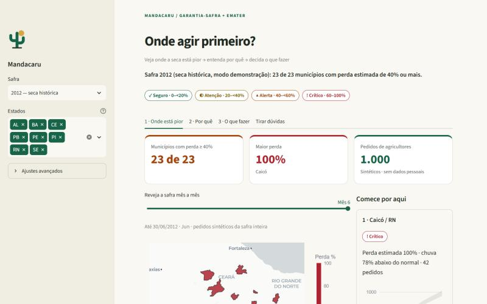

| Área | O que é | Para que serve |
|---|---|---|
| **Barra lateral** (esquerda) | **Safra** (o ano) e **Estados** (os 8 estados do semiárido). Abaixo, **Ajustes avançados**, fechado. | Escolher o que olhar. No dia a dia, só isso. |
| **"Onde agir primeiro?"** + a frase em negrito | Um resumo de uma linha: *"23 de 23 municípios com perda estimada de 40% ou mais"*. | Saber a gravidade da situação sem ler mais nada. |
| **Faixa "Veja onde a seca está pior → entenda por quê → decida o que fazer"** | O roteiro de uso. | Mostrar a quem nunca viu o painel por onde começar. |
| **Legenda de cores** | ✓ Seguro (verde) · ◐ Atenção (amarelo) · ▲ Alerta (laranja) · ! Crítico (vermelho), por faixa de perda. | A mesma cor significa a mesma coisa em todo o painel. Cada cor vem com ícone, para quem não distingue cores. |
| **Abas** | 1 · Onde está pior, 2 · Por quê, 3 · O que fazer, Tirar dúvidas. | Os passos do trabalho, na ordem. |

---

## Passo 1 · Onde está pior

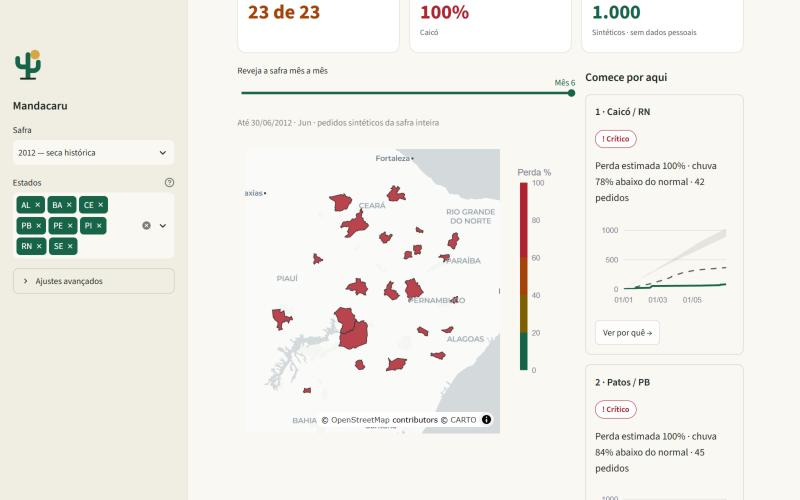

**O que é:** três cartões de resumo no topo (municípios com perda ≥ 40%, a maior perda, total de pedidos de
agricultores), o **mapa** dos 23 municípios e, à direita, **"Comece por aqui"** com os 3 mais críticos.

**Como funciona:**
- O mapa pinta cada município pela **perda estimada da safra**, calculada com a chuva real daquele ano comparada
  à chuva normal (média de 1991–2020). Passe o mouse sobre um município para ver os números; dá para dar zoom.
- "Comece por aqui" ordena os municípios do pior para o melhor. Cada cartão traz a perda, quanto a chuva ficou
  abaixo do normal, o número de pedidos de agricultores e um mini-gráfico da chuva da safra.

**Para que serve:** em 10 segundos, a coordenação sabe **onde** está o problema. O botão **"Ver por quê →"** leva
direto ao detalhe daquele município (passo 2).

### Rever a safra mês a mês

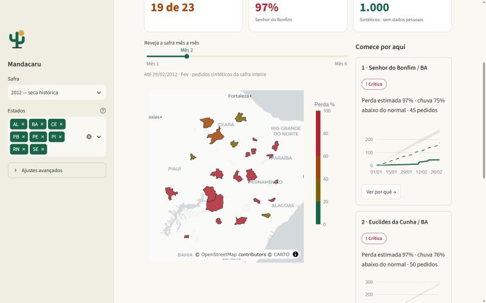

**O que é:** a barra **"Reveja a safra mês a mês"**, acima do mapa.

**Como funciona:** arraste de "Mês 1" (janeiro) a "Mês 6" (junho). O mapa e os cartões recalculam até aquela data.
No fim de fevereiro de 2012, **19 de 23** municípios já tinham passado de 40%, e alguns ainda estavam em laranja e
amarelo; em junho, todos estavam vermelhos.

**Para que serve:** ver a seca **se espalhar** e entender que alguns municípios entram em crise antes. No uso real,
o mês atual mostra a situação até hoje.

---

## Passo 2 · Por quê (o raio-x do município)

Clicar em **"Ver por quê →"** abre esta aba já no município escolhido (aqui, Caicó/RN). Também dá para trocar o
município no seletor do topo.

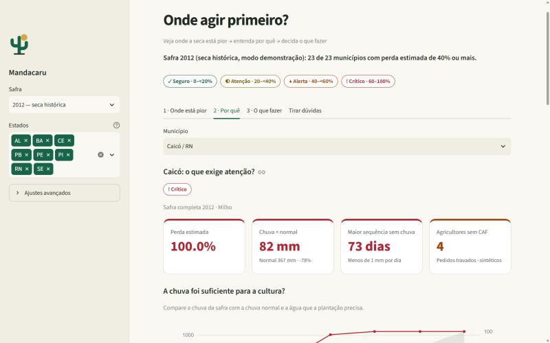

**Os quatro cartões:**
| Cartão | Exemplo (Caicó, 2012) | O que diz |
|---|---|---|
| Perda estimada | 100% | Quanto da safra de milho se perdeu por falta de água. Acima de 40% é o critério do programa. |
| Chuva × normal | 82 mm (normal 367 mm, −78%) | Quanto choveu de janeiro a junho, comparado a um ano normal. |
| Maior sequência sem chuva | 73 dias | O maior período seguido com menos de 1 mm por dia. |
| Agricultores sem CAF | 4 | Pedidos travados porque falta o cadastro CAF (sem CAF não há Garantia-Safra nem Pronaf). |

A cor de cada cartão segue a mesma legenda: aqui, todos em vermelho.

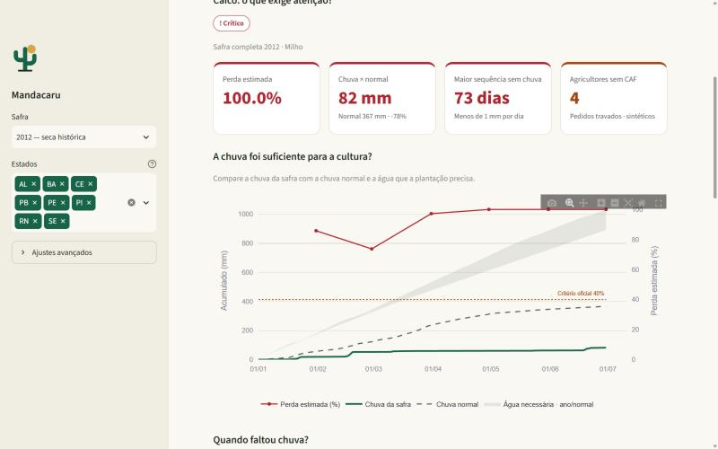

**"A chuva foi suficiente para a cultura?"** — como ler o gráfico:
- **Linha verde cheia:** chuva acumulada nesta safra.
- **Linha tracejada:** chuva acumulada num ano normal.
- **Faixa cinza:** a água de que a plantação precisaria.
- **Linha vermelha com pontos** (eixo da direita): a perda estimada ao longo dos meses.
- **Linha pontilhada "Critério oficial 40%":** a régua do programa.

Em Caicó, a chuva (verde) mal saiu do zero enquanto a necessidade (cinza) subia, e a perda ficou acima da linha de
40% desde janeiro. **Para que serve:** é a evidência que justifica pedir a vistoria.

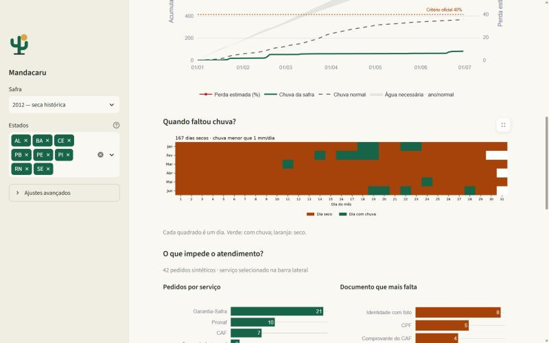

**"Quando faltou chuva?"** — cada quadradinho é um dia de janeiro a junho: **laranja = dia seco, verde = choveu**.
Caicó teve **167 dias secos** em 182. Serve para mostrar, num relance, que a seca não foi um mês ruim, foi a safra
inteira.

**"O que impede o atendimento?"** — dois gráficos com os pedidos que os agricultores daquele município mandaram
ao robô de triagem: **quais serviços pediram** (Garantia-Safra, Pronaf, CAF…) e **qual documento mais falta**
(identidade, CPF, comprovante do CAF…). Serve para planejar o atendimento: se falta CAF, é preciso um mutirão do
CAF antes; se falta identidade, avisar para levar.

### O que fazer neste município

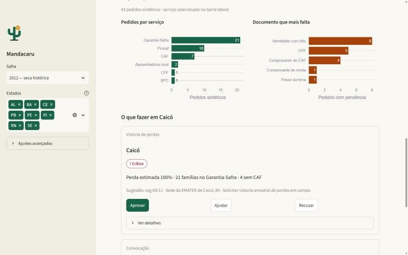

No fim da aba aparecem **as ações sugeridas para este município**, já na ordem certa: **vistoria** (sem ela
ninguém recebe) → **mutirão do CAF** (destrava pedidos) → **convocação** (chamar quem já tem documentação completa).

Cada cartão mostra a ação, o município, a gravidade, os números que a justificam e a **sugestão** já preenchida:
*"seg 09/11 · Sede da EMATER de Caicó, 8h"*. Três botões:
- **Aprovar** — aceita a sugestão como está. **Um clique.**
- **Ajustar** — abre o formulário para trocar data, local ou plano.
- **Recusar** — pede um motivo (obrigatório).

Assim, a coordenação **decide sem sair da tela** em que entendeu o problema.

---

## Passo 3 · O que fazer (decidir)

### Aprovar uma vistoria — 1 clique
Ao clicar **Aprovar** na vistoria de Caicó, o cartão sai da fila e aparece a confirmação
*"Decisão registrada para Caicó"*. A próxima ação sobe.

### Aprovar uma convocação — com revisão da mensagem
A convocação tem um passo a mais, de propósito: **um humano precisa ler a mensagem antes de ela chegar aos
agricultores.**

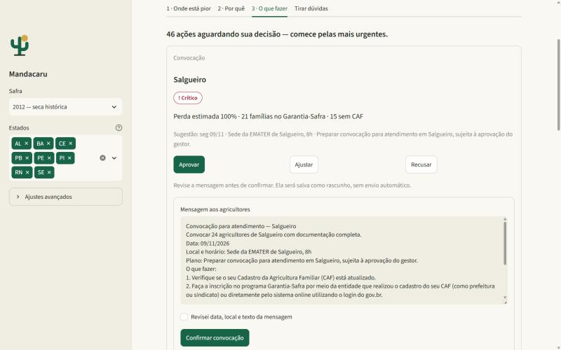

Ao aprovar, o painel escreve um **rascunho da mensagem**: quantos agricultores, data, local, plano e **o que eles
devem fazer e levar** — esse trecho é redigido pelo assistente de IA a partir da Carta de Serviço oficial do
Garantia-Safra. O texto pode ser editado ali mesmo.

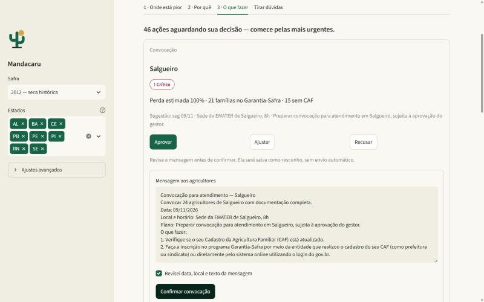

Para confirmar, é preciso marcar **"Revisei data, local e texto da mensagem"** e clicar em **Confirmar convocação**.
A mensagem fica salva como rascunho — **nada é enviado automaticamente**.

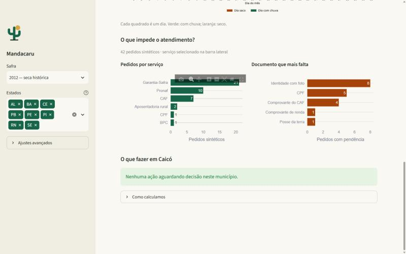

Com as duas ações decididas, o município mostra *"Nenhuma ação aguardando decisão neste município."*

### A fila do estado inteiro

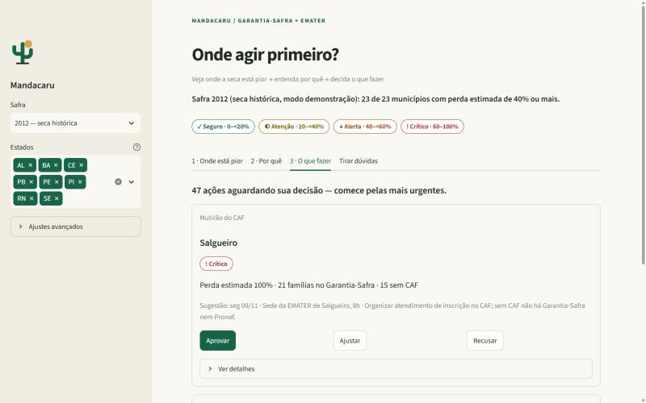

**O que é:** a aba 3 reúne as ações de **todos** os municípios: *"46 ações aguardando sua decisão — comece pelas
mais urgentes"*. Mostra 5 por vez (botão **"Mostrar mais 5"** no fim), da mais urgente para a menos urgente.

**Como a urgência é calculada:** combina a perda estimada (peso maior), o número de famílias com pedido de
Garantia-Safra e o número de pedidos travados por falta de CAF.

**Para que serve:** quem prefere trabalhar por lista, e não por mapa, resolve tudo daqui.

### Recusar — sempre com motivo

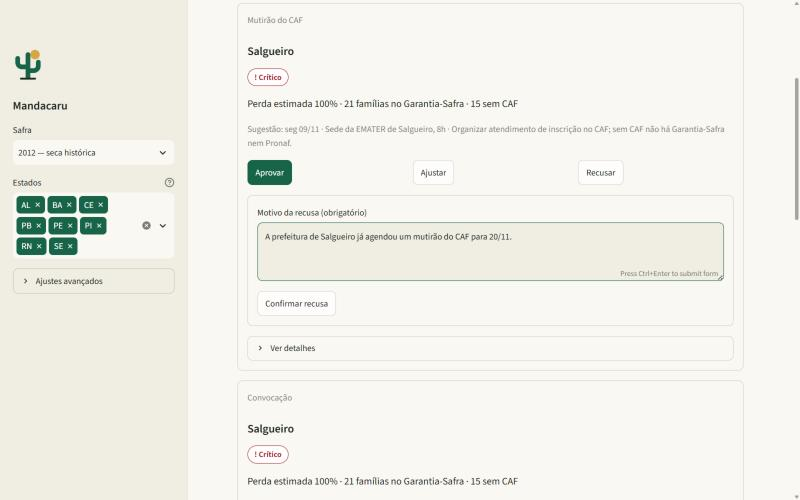

**Recusar** abre o campo **"Motivo da recusa (obrigatório)"**. Exemplo real de uso: *"A prefeitura de Salgueiro já
agendou um mutirão do CAF para 20/11."* Sem motivo, o painel não aceita.

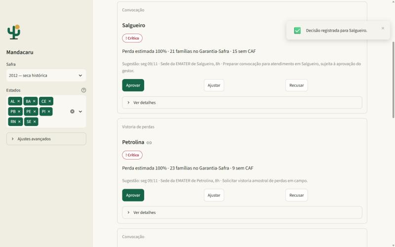

Toda decisão — aprovar, ajustar ou recusar — mostra a confirmação no canto da tela e tira o cartão da fila.

### Ajustar — quando a sugestão não serve

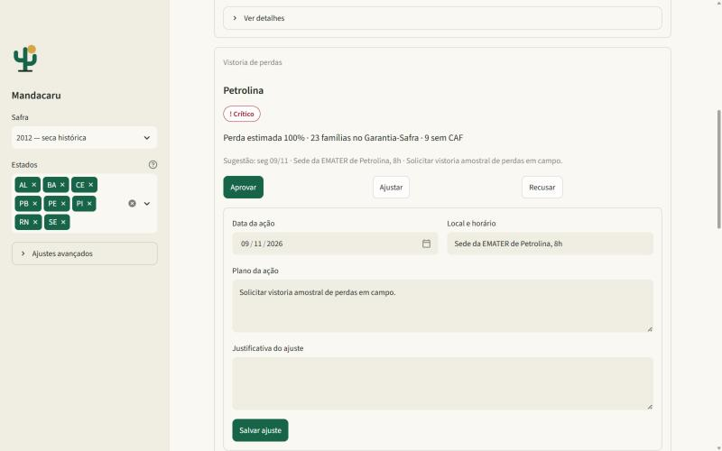

**Ajustar** abre o formulário **já preenchido** com a sugestão (data, local e horário, plano). Basta mudar o que
for preciso, escrever por que ajustou e **Salvar ajuste**.

### O histórico — quem decidiu o quê

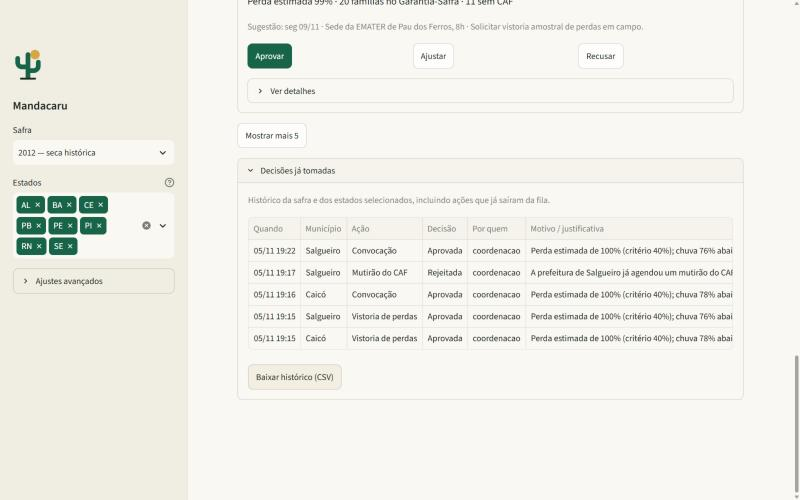

No fim da aba 3, **"Decisões já tomadas"** lista cada decisão: quando, município, ação, decisão (aprovada,
rejeitada, editada), por quem e o motivo. O botão **"Baixar histórico (CSV)"** exporta tudo. **Para que serve:**
prestação de contas — toda decisão fica registrada com a justificativa.

---

## Tirar dúvidas

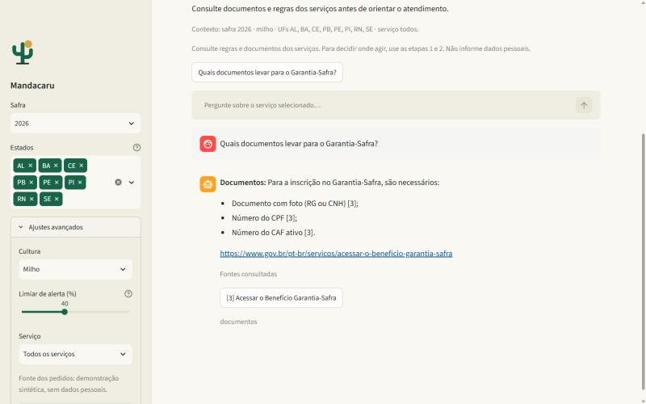

**O que é:** um assistente que responde **só com base nas Cartas de Serviço oficiais do gov.br**, citando a fonte.

**Como funciona:** clique em **"Ativar assistente"** (leva uns 20 segundos na primeira vez) e faça a pergunta, ou
clique na pergunta de exemplo. Para *"Quais documentos levar para o Garantia-Safra?"* ele responde: documento com
foto (RG ou CNH), número do CPF e número do CAF ativo — com o link oficial e a fonte consultada. Se a informação
não estiver nas cartas, ele diz que não encontrou, em vez de inventar.

**Para que serve:** tirar dúvidas de regra na hora, sem procurar no site. Ele não decide onde agir — isso é com os
passos 1 a 3.

---

## Ajustes avançados

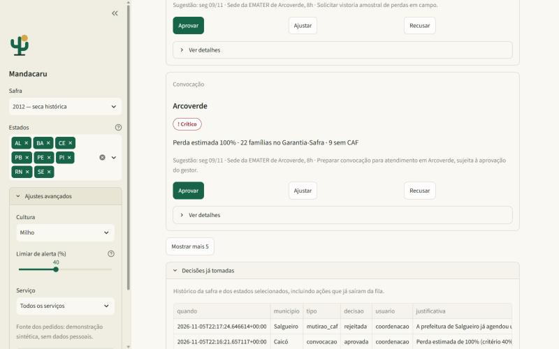

Fechados por padrão, porque o dia a dia não precisa deles:
| Ajuste | O que muda |
|---|---|
| **Cultura** | Milho ou feijão. Cada planta sofre de um jeito com a falta de água, então a perda estimada muda. |
| **Limiar de alerta** | A régua usada para destacar municípios (padrão 40%, o critério oficial). Útil para simular ("e se o critério fosse 30%?"); não muda as classes de cor nem aprova nada. |
| **Serviço** | Filtra os pedidos de agricultores por serviço (só Garantia-Safra, só CAF…). |
| **Atualizar dados** | Baixa de novo a chuva do Open-Meteo, com barra de progresso. Sem clicar, o painel usa os dados já salvos. |

---

## Comparando com um ano normal: a safra 2026

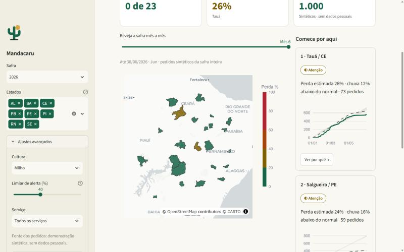

Trocando a **Safra** para 2026, o mapa fica **verde**: choveu acima do normal, e só dois municípios ficam em
atenção (amarelo). Mesmo painel, mesmos dados reais, outra realidade.

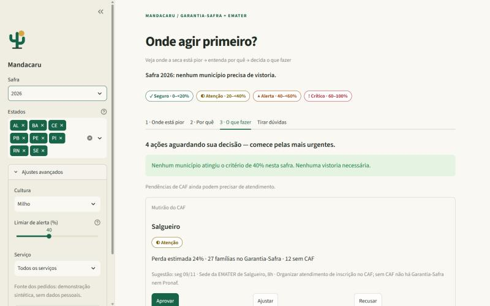

A aba 3 mostra o estado positivo: *"Nenhum município atingiu o critério de 40% nesta safra. Nenhuma vistoria
necessária."* Restam só alguns mutirões do CAF — pendência de documentação existe mesmo sem seca.

---

## Resumo de 1 minuto

1. **Abra o painel.** A frase do topo diz a gravidade da safra.
2. **Aba 1:** veja no mapa onde está vermelho. Em "Comece por aqui", clique **"Ver por quê →"** no primeiro.
3. **Aba 2:** confira chuva, dias secos e o que trava os agricultores. No fim, **Aprovar** a vistoria.
4. **Repita** para os próximos, ou use a fila da **aba 3**.
5. **Dúvida de regra?** Aba **Tirar dúvidas**.

**Caminho mínimo: 2 cliques** ("Ver por quê →" e "Aprovar") entre abrir o painel e mandar a vistoria para o
município mais crítico.

## Perguntas frequentes

**Os dados são reais?** A chuva (Open-Meteo), o mapa (IBGE) e as regras dos serviços (gov.br) são reais. Os
**pedidos dos agricultores são simulados** (sem nomes nem dados pessoais), porque o projeto não pode usar dados de
pessoas reais.

**O painel se atualiza sozinho?** Não. Ele abre com os dados já baixados e recalcula quando você muda um filtro. A
chuva só é baixada de novo pelo botão "Atualizar dados", nos Ajustes avançados.

**Aprovar no painel paga o benefício?** Não. O painel organiza a **decisão de onde agir** (pedir vistoria, fazer
mutirão, convocar). A perda estimada é uma aproximação; quem comprova a perda é a vistoria, e o pagamento segue o
processo oficial do programa.

**Alguma mensagem é enviada?** Não. As convocações aprovadas ficam salvas como rascunho, e toda decisão fica no
histórico.

---

## Esqueleto para o roteiro do vídeo (Front-end)

| Momento | Tela | O que mostrar / falar |
|---|---|---|
| Problema | 01 | Seca, Garantia-Safra, regra dos 40% e da vistoria; "onde mando os técnicos primeiro?" |
| Onde está pior | 02, 03 | Mapa vermelho, "Comece por aqui", **replay** de janeiro a junho (a seca se espalhando). |
| Por quê | 04, 05, 06 | Caicó: −78% de chuva, 73 dias sem chuva, 167 dias secos; documento que mais falta. |
| Decidir | 07, 08, 09 | Aprovar a vistoria em 1 clique; convocação com revisão humana da mensagem escrita pela IA. |
| Controle | 12, 19 | Recusa exige motivo; histórico com quem decidiu o quê. |
| Contraste | 17, 16 | 2026: mapa verde, "nenhuma vistoria necessária". |
| Código | — | Camadas providers/pipelines/state/ui/features, cache, componentes reutilizados (ver README). |
